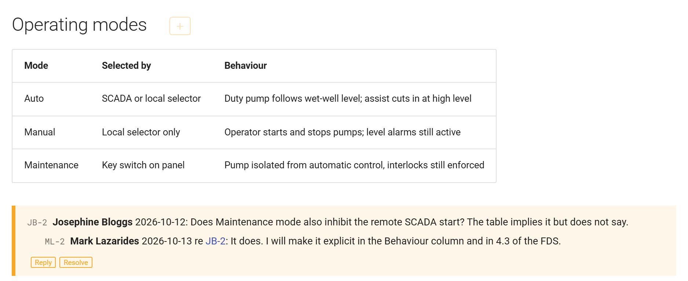
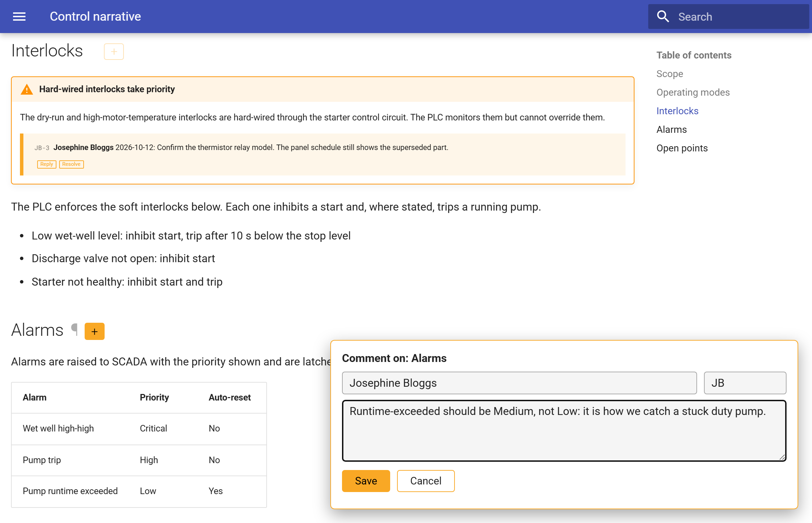
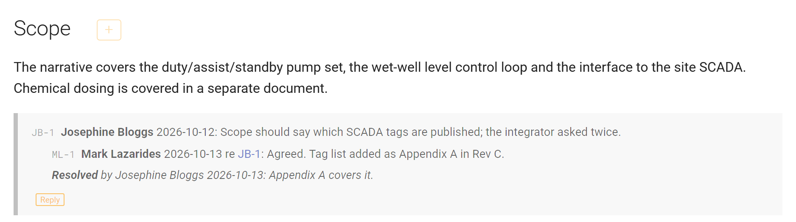
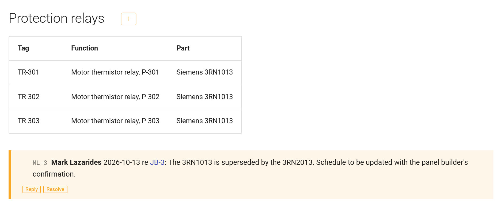

# mkdocs-review-comments

Review comments for MkDocs sites that live **in the markdown**, as tagged HTML comments. They
travel with the page, show up in `git diff`, need no server or database, and are invisible in
the issued site. A review build renders them in place, and a comment box on the rendered page
writes new ones straight back into the source.

## Commenting on the rendered page

Run the review build:

```bash
mkrc serve
```

and open it (default `http://127.0.0.1:8802/`). Every thread renders where it was written, under
the paragraph or table it refers to, with its id, authors, dates and Reply and Resolve buttons:



Hover any heading and a **+** button appears:


Click it, write the comment, and Save:



Save writes one line of markdown at the end of that section and the page rebuilds. The
author's name and initials are remembered in the browser. Reply and Resolve work the same
way, writing one line under the thread. A resolved thread renders greyed and keeps only Reply:



A reply can refer to a comment on another page. It becomes a thread of its own with a link
back, so a comment made on the narrative can be answered on the panel schedule:



Reviewers on other machines can comment too: serve on a network interface and the page finds
the API on the same host.

```bash
mkrc serve -a 0.0.0.0:8802
```

## What ends up in the markdown

The comment box and the command line both write lines like these, one per line, directly after
the paragraph or table they refer to:

```markdown
<!-- RC#DD-2 Josephine Bloggs 2026-10-12 | Does Maintenance mode also inhibit the remote SCADA start? -->
<!-- RC#ML-2 Mark Lazarides 2026-10-13 re DD-2 | It does. I will make it explicit in the table. -->
<!-- RC#DD-2 resolved Josephine Bloggs 2026-10-14 | Rev C reads correctly. -->
```

- **Id.** The author's initials and the author's own running number (`ML-2`). Two people
  commenting on separate branches never collide, and ids are never reused, even after archiving.
- **Thread.** A root comment plus the comment lines directly beneath it: replies and the
  resolution line. A reply carries its own id and `re <id>`. `re` may point at a comment on
  another page, in which case the reply is a thread of its own with a link back.
- **Resolve.** A line that reuses the root id with the word `resolved`. The thread stays in the
  page until it is archived to the comment log.
- **Names** may contain spaces. The text may not contain `|`, which separates the header from
  the text, and must be one line. The tools enforce this; the rules are for hand-written comments.
- **Placement.** Never between two table rows. Inside an admonition, keep the indent. Inside a
  fenced code block a comment is just text, so the grammar can be documented in the docs.

## Install and configure

```bash
pip install git+https://github.com/mark-lazarides/mkdocs-review-comments.git
```

or, for development, `pip install -e .` from a clone. Then in `mkdocs.yml`:

```yaml
plugins:
  - search
  - review-comments
```

Options, all optional:

```yaml
  - review-comments:
      tag: RC                          # the tag inside <!-- RC#... -->
      log_page: reviews/comment-log.md # where `mkrc archive` moves resolved threads
      review: false                    # true renders threads in place
      api_url: http://127.0.0.1:8803   # where the comment box posts, when not served by `mkrc serve`
```

## Two builds

A normal build (`mkdocs build`, `mkdocs serve`) strips every tagged comment, so the issued site
carries nothing.

A review build renders each thread in place with an anchor (`#rc-DD-2`), so a comment has a URL
and every `re` is a link, across pages and into the log once a thread is archived. Review mode is
on when any of these holds:

- the plugin option `review: true`;
- the environment variable `RC_REVIEW=1`, which `mkrc serve` sets;
- `extra.review_comments: true` in the config, convenient in an `INHERIT` file:

```yaml
# mkdocs.review.yml
INHERIT: mkdocs.yml
extra:
    review_comments: true
```

The site name gains " (review build)" so the two are easy to tell apart.

## The command line

```
mkrc list            # open threads by page
mkrc list --all      # including resolved
mkrc check           # duplicate ids, replies to unknown ids, malformed lines, comments that would break a table
mkrc reply   DD-14 "text" --by "Mark Lazarides" --as ML
mkrc resolve DD-14 "text" --by "Mark Lazarides"
mkrc delete  DD-14   # remove a thread outright (junk or test comments)
mkrc archive         # move resolved threads to the comment log page
mkrc serve [-a IP:PORT] [--api-port N]
```

`mkrc` reads `mkdocs.yml` in the current folder for the docs directory and the plugin options
(`-f` for another config). With no MkDocs config at all, `--docs <folder>` scans a plain folder
of markdown; the grammar and the CLI do not depend on MkDocs.

`mkrc check` is cheap and worth running in CI.

`mkrc serve` runs the review build and a small comment API in one process. It refuses to start
if either port is already in use, naming the port, because Windows will otherwise let two copies
bind the same port and answer at random. Ctrl-C stops both.

## Try it

The `example/` folder is a small Material for MkDocs site with a few threads already in it:

```bash
pip install mkdocs-material
mkrc -f example/mkdocs.yml serve
```

Open `http://127.0.0.1:8802/`, add a comment, and look at `example/docs/index.md` afterwards.
`mkdocs build -f example/mkdocs.yml` shows the issued site with nothing in it.

## Notes

- Every write preserves the page's line endings, BOM and final newline, so a comment is a
  one-line diff on Windows and Unix alike.
- With click 8.2, `mkdocs serve` silently loses its live-reload default and never rebuilds on
  file changes. `mkrc serve` forces it on. If you run `mkdocs serve` by hand, pass `--livereload`.
- The rendered threads use Material for MkDocs' CSS variables where present and plain colours
  otherwise, so other themes work, just less tidily. A review build enables the `attr_list`
  Markdown extension if the site does not already, since the rendered threads carry their class
  and anchor that way.
- Python 3.10 or later.

## Development

```bash
pip install -e .[test]
pytest
```

The screenshots above are generated from the example site by `python example/screenshots.py`,
which needs `mkdocs-material` and `playwright` (plus `playwright install chromium`).
